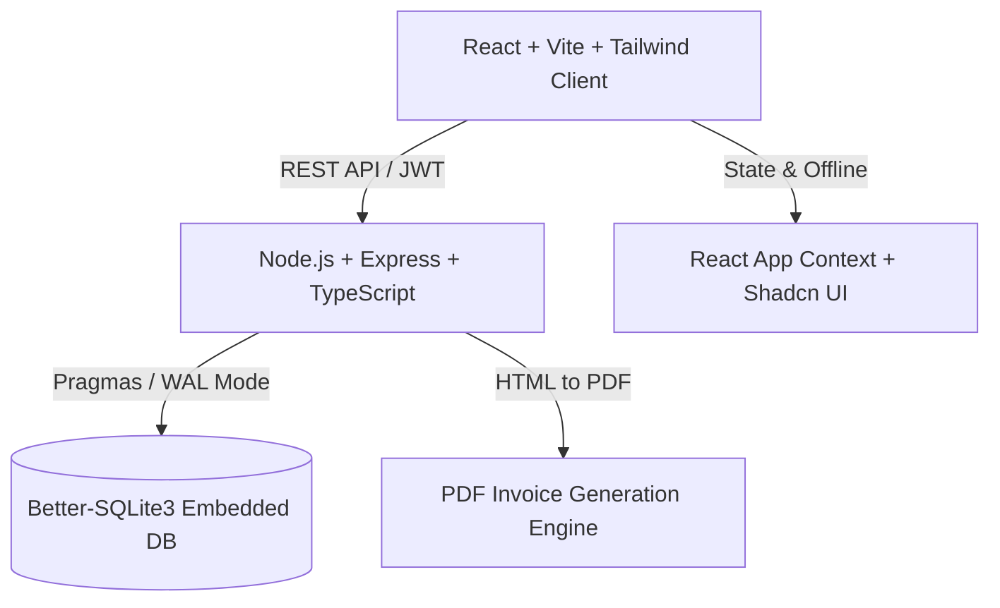

# 💼 BillFlow — Enterprise Invoicing & Financial Management System

[](https://reactjs.org/)
[](https://www.typescriptlang.org/)
[](https://nodejs.org/)
[](https://expressjs.com/)
[](https://sqlite.org/)
[](https://tailwindcss.com/)
[](https://vitejs.dev/)
[](https://opensource.org/licenses/MIT)

**BillFlow** (Facturation Suite) is a modern, full-stack enterprise billing, quote estimation, and client ledger platform. Engineered for small-to-medium businesses and accounting teams, it streamlines invoice lifecycle management from initial estimate to definitive tax settlement and automated PDF invoice generation.

---

## 🌟 Key Features

### 📑 1. Comprehensive Invoice Management
- **Multi-Type Billing:** Create and manage **Proforma**, **Definitive**, and **Credit Note (Avoir)** invoices.
- **Automated Tax Calculations:** Dynamic TVA rate computation, fiscal stamps (*timbre fiscal*), advance deductions (*retenue de garantie*), and commercial discounts.
- **French Amount to Words:** Automated conversion of numerical totals to written legal French text for compliant invoice headers.

### 📋 2. Quotation & Estimation (Devis)
- Multi-item quote generation with dynamic line items, units (Forfait, Jours, Semaines), and unit prices.
- **1-Click Conversion:** Convert accepted quotes directly into official definitive invoices with full audit continuity.

### 👥 3. Client Registry & Fiscal Records
- Complete tracking of client fiscal identifiers: **SIRET, Matricule Fiscale, Registre de Commerce (RC), NIS, Article d'imposition**.
- Client segmentation: Local vs. Foreign entities, and customer tiers (New, Recurring, VIP).

### 🔐 4. Role-Based Access Control (RBAC)
- Built-in permission separation between **Administrator** (full fiscal, settings, user control, backup/restore) and **Commercial** (quote and invoice drafting).

### 📊 5. Financial Dashboard & PDF Engine
- Real-time revenue analytics, overdue payment tracking, and high-fidelity PDF invoice rendering.

---

## 🏗️ Architecture & Technology Stack



### Frontend (`billflow-client-scribe`)
- **React 18** with **TypeScript** & **Vite**
- **Tailwind CSS** + **Radix UI / Shadcn UI** components
- **Lucide Icons** & **Recharts** for analytics visualization

### Backend (`billflow-backend`)
- **Node.js** & **Express** in **TypeScript**
- **Better-SQLite3** for high-throughput ACID database operations with WAL journaling
- **BcryptJS** password encryption & **JWT** stateless authentication
- **Express-Validator** & **Helmet** security middleware

---

## 🚀 Quickstart Guide

### Prerequisites
- [Node.js](https://nodejs.org/) v18+ or v20+
- npm or yarn

### 1-Click Startup (Windows)
Double-click **`run_dev.bat`** to automatically install dependencies, seed the mock database, and launch both frontend and backend concurrently.

---

### Manual Setup

#### 1. Start the Backend API
```bash
cd billflow-backend
npm install

# Seed the database with mock enterprise data
npm run seed

# Run in development mode (Port 5000)
npm run dev
```

#### 2. Start the Frontend Client
```bash
cd ../billflow-client-scribe
npm install

# Launch Vite development server (Port 5173)
npm run dev
```

Open your browser at **`http://localhost:5173`**.

---

## 🔑 Demo Login Credentials

The mock database is pre-seeded with two accounts:

| Role | Username | Password | Access Level |
| :--- | :--- | :--- | :--- |
| **Administrator** | `admin` | `admin123` | Full control (Financials, Users, Backups, Invoices) |
| **Commercial** | `commercial` | `commercial123` | Operational (Quotes, Invoices, Client View) |

---

## 📂 Project Structure

```
billflow-invoicing-saas/
├── billflow-backend/            # Node.js + Express + TypeScript API
│   ├── src/
│   │   ├── config/database.ts   # SQLite schema & foreign key constraints
│   │   ├── controllers/         # Invoices, Quotes, Clients & Auth logic
│   │   ├── routes/              # Express API endpoints
│   │   ├── scripts/             # Mock data seeder (seed_mock_data.ts)
│   │   └── services/            # Business calculations & PDF generation
│   ├── package.json
│   └── tsconfig.json
├── billflow-client-scribe/      # React + Vite + Tailwind frontend
│   ├── src/
│   │   ├── components/          # Invoices, Quotes, Clients & Dashboards
│   │   ├── contexts/            # Global AppContext & Auth state
│   │   ├── services/api.ts      # Axios / Fetch client
│   │   └── utils/               # PDF generator & tax calculation utilities
│   ├── package.json
│   └── vite.config.ts
├── run_dev.bat                  # 1-Click launcher
├── docker-compose.yml           # Multi-container deployment config
└── README.md
```

---

## 📄 License
This project is licensed under the MIT License — see the [LICENSE](LICENSE) file for details.
